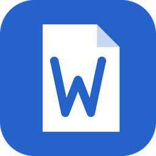

<p align="center">
  
</p>

<h1 align="center">Word</h1>

<p align="center">
  Procesador de textos nativo y de código abierto, escrito en Rust, con el flujo de trabajo que ya conoces:
  cinta de opciones, estilos, tablas, control de cambios, referencias y combinación de correspondencia.
</p>

> **Fork personal.** Este repositorio es una copia independiente de
> [storytold/wordcraft](https://github.com/storytold/wordcraft) (versión 0.8.0 como base) con
> la identidad visible cambiada a **Word**, icono propio y compilaciones automáticas en GitHub Actions.
> No está afiliado a Microsoft ni al equipo original. «Word» aquí es solo el nombre de este fork; el icono
> es original y no usa la marca de Microsoft Word.

## Qué es

- Lee y escribe `.docx`, abre `.odt`, `.rtf`, `.html`, `.md` y `.txt`, y exporta a PDF.
- Aplicación de escritorio (Linux, Windows) y herramienta de línea de comandos `word-cli`.
- Interfaz y motor 100 % Rust (egui/wgpu); sin servicios en la nube.

## IA (propio de este fork)

La pestaña **IA**, junto a Ayuda, tiene dos botones para elegir el agente — **Claude** (Claude Code) o
**Codex** — que abren un chat dedicado donde el agente escribe y edita en directo el documento abierto:

- Chat limpio: solo tus mensajes y sus respuestas; mientras trabaja, una línea en vivo dice qué hace
  («Escribiendo», «Diseñando la portada»…) sin mostrar herramientas ni pasos técnicos.
- Adjunta archivos (texto, PDF, imágenes) desde el botón **+**; el agente los lee y puede insertar imágenes.
- **Diseño del documento**: portada (clásica, banda, minimalista, moderna), paleta y tipografía,
  índice, numeración, encabezado y espaciado, con vista previa. Se aplica al instante sin gastar tokens.
- Continuidad: cada documento guarda su conversación y la sesión del agente; si una tarea se detiene
  (o se cierra la app), **Continuar** sigue donde se quedó sin repetir lo hecho.
- Ahorro de tokens: prompt de sistema propio y corto, solo las herramientas del documento, sesiones
  reanudadas y modelo Automático (Sonnet) por defecto; Opus y Haiku a un clic.

Usa tu propia instalación de `claude` o `codex` (tu cuenta y tu plan). La app arranca su canal de
control local y conecta el agente con `word-cli mcp --connect`; el código está en
`crates/ui-egui/src/ai_pane/`.

## Descargar e instalar

Las compilaciones se publican en [Releases](https://github.com/JUANJOIC005/Word/releases).

**Linux (Debian/Ubuntu y derivadas, x86_64):**

```sh
sudo apt install ./Word-<versión>-linux-x86_64.deb
word            # abre la aplicación
word-cli --help # herramienta de línea de comandos
```

Windows se compila con los workflows de `.github/workflows` (artefactos de cada ejecución).

## Compilar

Todo se compila en GitHub Actions, no hace falta toolchain local. El workflow
[`release.yml`](.github/workflows/release.yml) (manual con *Run workflow*, o al subir una etiqueta `v*`)
usa Rust 1.95 (edición 2024) con caché de cargo, genera el `.deb` con `packaging/linux/package.sh`
y lo adjunta como artefacto y como asset de la Release.

Para compilar a mano: `cargo build --release -p wordcraft -p wordcraft-cli` (los binarios compilados se
llaman `wordcraft`/`wordcraft-cli`; el empaquetado los instala como `word`/`word-cli`).

## Relación con el proyecto original

- Los crates internos conservan el prefijo `wordcraft-*` a propósito: así las mejoras del proyecto
  original se incorporan con pocos conflictos.
- Lo que cambia en este fork: nombre visible, icono, identificador de escritorio
  (`io.github.juanjoic005.word`), nombres de paquete y ejecutables, enlaces y workflows de release.

Para traer novedades del original:

```sh
git remote add upstream https://github.com/storytold/wordcraft.git
git fetch upstream
git merge upstream/main   # resolver conflictos de nombre/identidad si los hay
```

## Licencia y atribución

MIT OR Apache-2.0 (ver [`LICENSE-MIT`](LICENSE-MIT), [`LICENSE-APACHE`](LICENSE-APACHE) y
[`NOTICE`](NOTICE)). Software original © sus colaboradores; terceros y fuentes en
[`ATTRIBUTION.md`](ATTRIBUTION.md). Los logotipos de ArtCraft se han eliminado de este fork.
